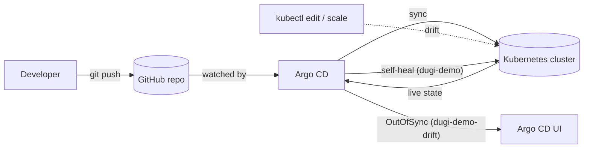

<div align="center">

# 🔁 Dugi GitOps Demo

**Git as the single source of truth for Kubernetes — with Argo CD.**

A hands-on demo of GitOps with [Argo CD](https://argo-cd.readthedocs.io/): automated sync, self-healing, and how **configuration drift** is detected when someone changes the cluster by hand.


</div>

---

## 💡 What this demonstrates

In GitOps, the desired state of the cluster lives in Git. Argo CD continuously compares Git with what is actually running and reports — or fixes — any difference.

This repo contains **two identical apps with different sync policies**, so you can see both behaviours side by side:

| App | Path | Sync policy | What happens on drift |
|---|---|---|---|
| **`dugi-demo`** | [`k8s/`](k8s) | 🤖 Automated · prune · **self-heal** | Manual changes are **reverted automatically** |
| **`dugi-demo-drift`** | [`k8s-drift/`](k8s-drift) | ✋ Manual | Argo CD marks the app **OutOfSync** and waits for you |



## 📁 Repository structure

```
.
├── argocd/
│   ├── dugi-demo-application.yaml         # Automated sync + self-heal
│   └── dugi-demo-drift-application.yaml   # Manual sync (drift demo)
├── k8s/                                   # Desired state for dugi-demo
│   ├── deployment.yaml                    # nginx:1.27-alpine, 2 replicas
│   └── service.yaml                       # ClusterIP on port 80
└── k8s-drift/                             # Desired state for dugi-demo-drift
    ├── deployment.yaml
    └── service.yaml
```

## 🚀 Getting started

### Prerequisites

- A Kubernetes cluster (e.g. [kind](https://kind.sigs.k8s.io/), minikube, AKS, EKS)
- `kubectl` configured against it
- Argo CD installed in the `argocd` namespace

<details>
<summary>Install Argo CD (if you don't have it)</summary>

```bash
kubectl create namespace argocd
kubectl apply -n argocd -f https://raw.githubusercontent.com/argoproj/argo-cd/stable/manifests/install.yaml

# Admin password
kubectl -n argocd get secret argocd-initial-admin-secret -o jsonpath="{.data.password}" | base64 -d

# UI at https://localhost:8080
kubectl port-forward svc/argocd-server -n argocd 8080:443
```

</details>

### Deploy the apps

```bash
kubectl apply -f argocd/
```

Argo CD now picks up both applications. `dugi-demo` syncs automatically; `dugi-demo-drift` must be synced once by hand:

```bash
argocd app sync dugi-demo-drift
```

## 🧪 Try it: create drift

### 1. Self-heal in action (`dugi-demo`)

```bash
kubectl scale deployment dugi-demo --replicas=5
kubectl get deployment dugi-demo -w
```

Argo CD notices the difference and scales it back to **2 replicas** — Git wins.

### 2. Drift detection (`dugi-demo-drift`)

```bash
kubectl scale deployment dugi-demo-drift --replicas=5
argocd app get dugi-demo-drift
```

The app is now **`OutOfSync`**. Argo CD shows exactly what differs (`spec.replicas: 2 → 5`) but does **not** change anything. Restore the desired state with:

```bash
argocd app sync dugi-demo-drift
```

### 3. The GitOps way

Change `replicas` in [`k8s/deployment.yaml`](k8s/deployment.yaml), commit and push — Argo CD rolls it out automatically. No `kubectl` needed.

## 🎯 Key takeaways

- **Git is the source of truth** — every change is reviewed, versioned and auditable
- **Self-heal** prevents configuration drift and undocumented "quick fixes"
- **Manual sync** fits sensitive environments where a human must approve changes
- **Rollback** is just `git revert`

## 🧹 Clean up

```bash
kubectl delete -f argocd/
kubectl delete -f k8s/ -f k8s-drift/
```

---

<div align="center">

Built by **[Dugi Selmanaj](https://github.com/ddugi)** · [DVS Konsult](https://dvskonsult.se)

</div>
